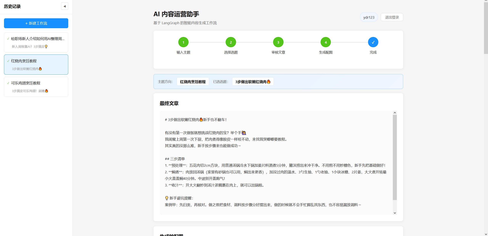
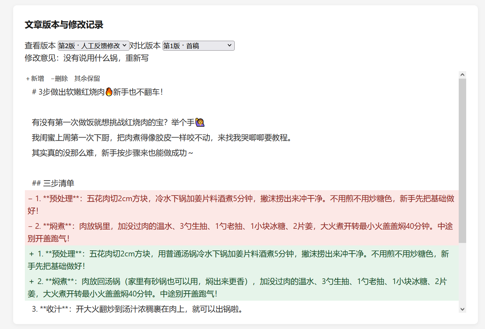
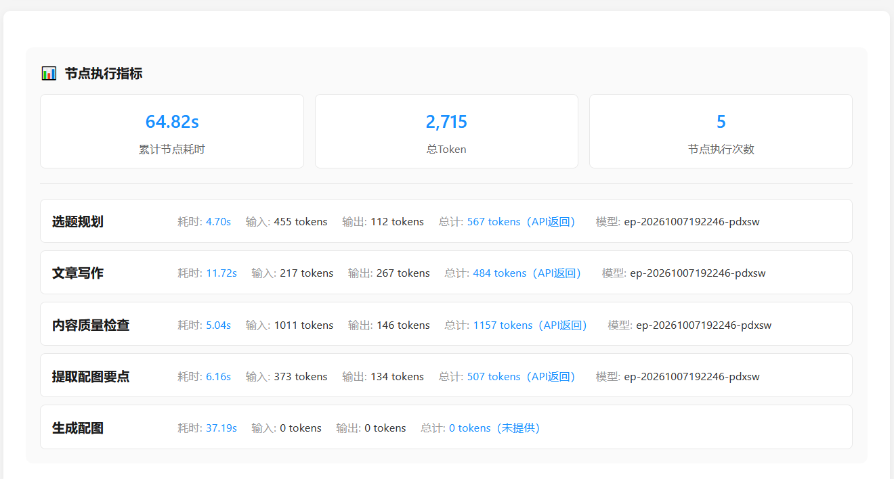
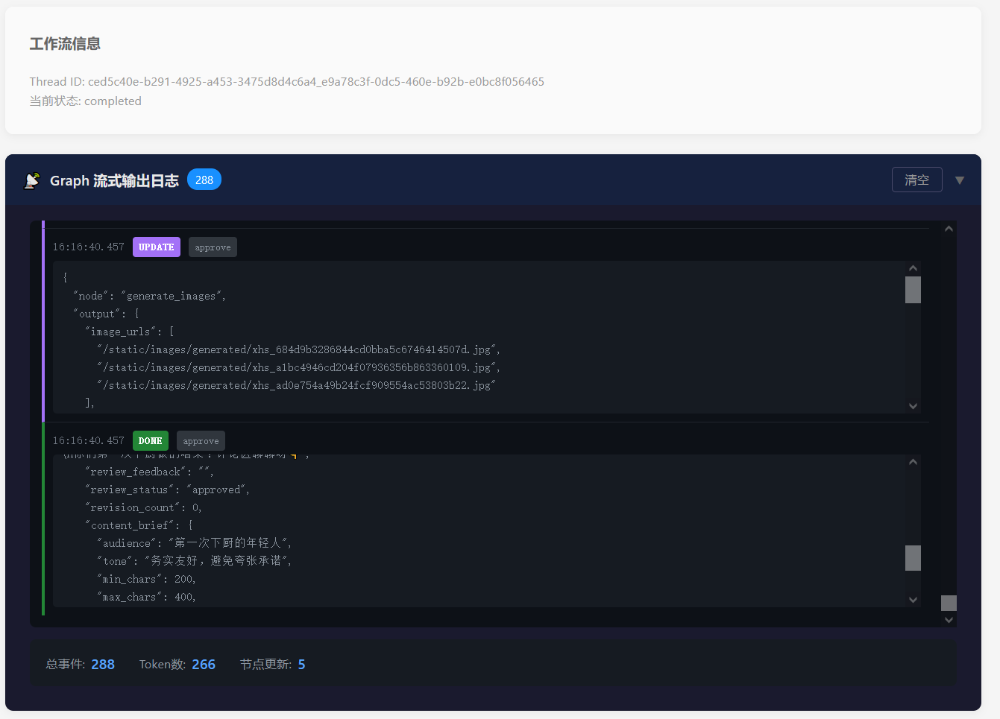
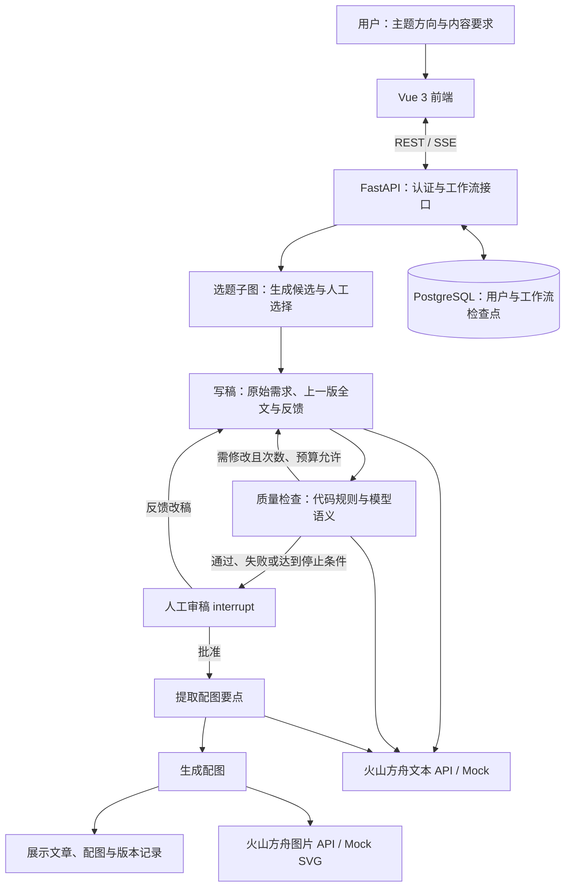

# 自媒体图文创作与审稿 Agent

<div align="center">

**基于 LangGraph 的选题、写作、质量检查与配图工作流**

Vue 3 · FastAPI · LangGraph 1.0 · PostgreSQL · 火山方舟

[](frontend/package.json)
[](pyproject.toml)
[](https://github.com/Drong-Yang/ai-content-assistant/actions/workflows/ci.yml)

[哔哩哔哩演示](https://b23.tv/hs6Kisa) · [飞书演示文档](https://my.feishu.cn/wiki/HhTcwcQUei1PVkkNTAycuLacnWb?from=from_copylink) · [关键设计](#关键设计) · [快速开始](#快速开始)

</div>

## 项目介绍

面向自媒体图文创作的人机协同应用。输入主题方向和内容要求后，AI 生成候选选题；用户确定选题，系统流式写稿并进行质量检查；用户可提出修改意见、比较文章版本，审核通过后再提取配图要点并生成图片。

项目重点处理三个问题：修改意见容易脱离原始需求，反复生成难以追踪文章变化，长流程中断后难以继续。实现上通过 LangGraph 状态图编排、有限次质量检查与自动修订、文章版本记录和 PostgreSQL 检查点，将创作过程保存为可暂停、可恢复、可回看的工作流。

项目演示：[哔哩哔哩（Bilibili）](https://b23.tv/hs6Kisa) · [飞书视频演示文档](https://my.feishu.cn/wiki/HhTcwcQUei1PVkkNTAycuLacnWb?from=from_copylink)

> 当前提供内容创作与人工审核，不会自动发布到小红书或其他平台。质量检查建议不等于事实核验或流量预测；文章与配图仍需人工核对。

## 目录

- [核心能力](#核心能力)
- [界面展示](#界面展示)
- [实现与源码](#实现与源码)
- [架构与数据流](#架构与数据流)
- [关键设计](#关键设计)
- [环境](#环境)
- [快速开始](#快速开始)
- [测试与评测](#测试与评测)
- [目录结构](#目录结构)
- [常见问题](#常见问题)

## 核心能力

- **选题与写作**：输入主题方向、目标读者、语气、篇幅、必含栏目与保留文本，人工确定选题后流式生成正文。
- **质量检查与自动修订**：代码检查篇幅、栏目与保留文本，模型检查受众、需求落实和可操作性；在次数与预算允许时自动修订，再交人工审稿。
- **定向改稿与版本对比**：改稿时同时传入原始需求、上一版全文与本轮意见，保留父版本、反馈和触发来源，前端展示文本增删差异。
- **人在环与持久化恢复**：选题、审稿两处人工中断，PostgreSQL 保存检查点；支持刷新页面、应用重启后继续任务，以及失败节点重试。
- **配图与异常状态**：人工批准后提取配图要点并生成图片，图片部分失败时保留状态，支持重试。
- **过程可见**：注册登录、按用户隔离的工作流历史、SSE 流式事件、节点耗时与 Token 用量来源展示。
- **两种运行模式**：支持火山方舟真实文本与图片 API，也提供明确标识的模拟文本和 SVG 配图；模拟模式仍需 PostgreSQL。

## 界面展示

以下为项目演示过程截图。截图中的耗时、Token 与模型标识对应单次运行，不作为性能基准或费用承诺。

### 创作结果与历史记录



<details>
<summary>展开查看配图、版本对比、节点指标与流式日志</summary>

### AI 生成配图


### 文章版本与修改记录



### 节点执行指标



### 工作流状态与流式事件



</details>

## 实现与源码

在 `graph_xiaohongshu` 教学项目基础上改造，主要实现集中在以下模块：

- **状态图与人工中断**：[workflow.py](app/graph/workflow.py) 组装节点、条件路由和人工审稿；[选题子图](app/graph/subgraphs/topic_selection.py) 处理候选选题与人工选择；[utils.py](app/graph/utils.py) 提供检查点接入。
- **写作与质量闭环**：[writer.py](app/graph/nodes/writer.py) 管理改稿上下文和版本记录；[quality_check.py](app/graph/nodes/quality_check.py) 执行检查和停止决策；[quality.py](app/graph/quality.py) 定义输入、检查报告与规则。
- **模型与配图接入**：[llm_service.py](app/services/llm_service.py) 处理文本生成、语义检查与用量；[visualizer.py](app/graph/nodes/visualizer.py) 和 [image_service.py](app/services/image_service.py) 提取配图要点并调用图片 API。
- **接口与交互**：[工作流 API](app/api/v1/workflow.py) 提供启动、恢复、重试、历史及 SSE；[App.vue](frontend/src/App.vue) 展示创作和审核过程；[version-diff.js](frontend/src/version-diff.js) 在本地计算版本差异。
- **回归与评测**：[后端流程回归](test_reproduction.py)、[质量闭环测试](test_quality_upgrade.py)、[固定改稿评测](scripts/evaluate_revision.py) 与 [GitHub Actions](.github/workflows/ci.yml)。

## 架构与数据流



LangGraph 负责编排、状态与中断恢复，项目代码定义检查标准、修订路由和停止条件。用户选题与人工审稿是显式决策点；即使自动检查通过，仍需用户批准后才能生成配图。

## 关键设计

### 1. 有限次质量检查，异常时保留文章并转人工

采用 Evaluator–optimizer 工作流，将确定性的篇幅、栏目、保留文本交给代码检查，把受众、需求与可操作性交给结构化模型检查。语义检查引用正文段落编号，程序校验引用并回填原文。

默认每轮人工审核前最多自动修订一次，整个工作流累计最多三次，并设置检查预算与超时。JSON 无效、引用不存在、检查失败或达到上限时明确转人工，不将异常标记为通过。预算用于调用准入，不是供应商账单的硬上限。

### 2. 定向改稿保留原始需求和版本关系

改稿同时使用原始方向、内容要求、上一版全文和本轮意见，避免仅凭一句反馈重新生成。版本保存父版本、正文、反馈、触发来源及关联指标，区分首稿、自动修订与人工反馈修改。前端采用本地行级文本比较，无需再次调用模型。

### 3. 检查点承接暂停、重启与失败恢复

使用 PostgreSQL 保存 LangGraph 检查点，选题与审稿通过 `interrupt()` 暂停，后续提交决策继续执行。接口校验工作流归属；节点失败和图片部分失败保留可见状态，通过重试接口继续处理。图片重试当前会整批重新生成，不是只补失败项。

### 4. 正文流与节点事件分开展示

SSE 只将写稿节点的正文片段展示为文章，质量检查 JSON 通过节点事件更新面板。开始新版本时清空流式正文，避免首稿和修订稿混在一起。节点指标区分 API 返回、估算或未提供的用量来源，累计节点耗时不代表包含人工等待的总耗时。

配置、旧检查点兼容、失败处理和验证方法见[质量闭环与版本说明](docs/QUALITY_UPGRADE.md)。

## 环境

Python **3.13**（与 pyproject.toml / uv.lock 一致）、Node.js 22、npm、Docker Compose。无需本地 GPU。模拟模式也需要 PostgreSQL。

## 快速开始

下载或克隆本仓库后，在仓库根目录执行。无需外部工作区脚本。

### 1. 配置与数据库

`.env`、日志、生成图片和数据库包含本机配置或用户数据，请勿提交到仓库。

复制 `.env.example` 为 `.env`（PowerShell：`Copy-Item .env.example .env`；macOS/Linux：`cp .env.example .env`）。

- 将 `POSTGRES_PASSWORD` 改为自己的随机密码（建议使用字母数字，避免连接串转义问题）。
- 将 `DATABASE_URL`、`POSTGRES_URI` 中的 `CHANGE_ME` 替换为同一密码。
- 将 `JWT_SECRET_KEY` 改为长随机字符串。
- 首次体验设置 `MOCK_MODE=true`，无需模型密钥。

```bash
docker compose up -d --wait
```

数据库只绑定本机 `5432`。若端口已被占用，请先停止已有数据库，或同时修改 compose.yaml 的映射端口与两个数据库连接串。持久卷已有数据时，修改 `.env` 不会修改卷内密码。

### 2. 后端

```bash
python -m venv .venv
```

PowerShell 激活：`.\.venv\Scripts\Activate.ps1`；macOS/Linux 激活：`source .venv/bin/activate`。

```bash
python -m pip install -r requirements.txt
python run_server.py
```

已安装 uv 时也可用 `uv sync --frozen` 安装锁定版本，再 `uv run python run_server.py`。Windows 请使用 `run_server.py`，其中选择兼容 psycopg 的事件循环。

API 文档：<http://127.0.0.1:8000/docs>；健康检查：<http://127.0.0.1:8000/health>。

### 3. 前端

另开终端：

```bash
cd frontend
npm ci
npm run dev
```

打开 <http://127.0.0.1:5173>，注册账号并登录。前端开发服务代理 `/api` 与 `/static` 到本机 8000 端口。

### 4. 真实模型

将 `MOCK_MODE=false`，填写自己的 `LLM_API_KEY`、`LLM_MODEL`；配图需要 `IMAGE_MODEL` 与 `IMAGE_API_KEY`（为空时复用文本密钥）。模型填实际开通的模型 ID 或接入点，API 地址以自己的服务区域为准。重启后端后生效，真实调用会产生云服务费用。

### 停止

前后端终端分别按 Ctrl+C，执行 `docker compose stop` 停止数据库并保留数据。不要用 `docker compose down -v` 排错，否则会删除持久卷。

## 测试与评测

使用专用测试数据库及专用 `.env` 执行，流程测试会创建用户和工作流记录，勿连接生产数据库。回归测试使用模拟模型，不调用真实云服务。

```bash
python -m unittest test_quality_upgrade test_reproduction -v
cd frontend
node --test src/version-diff.test.js
npm run build
```

GitHub Actions 为集成测试启动独立 PostgreSQL 服务，运行后端回归、前端版本差异测试与生产构建。本地验证范围见[验证记录](docs/VALIDATION.md)。模拟测试通过不代表真实文本、图片 API 已在本次发布重新验收。

仓库提供 [20 题固定改稿任务](evals/README.md)和[正式评测报告](docs/EVALUATION_2026-11-02.md)。在已记录的单次真实文本 API 对比中，全部机械约束均通过的任务从旧提示的 3/20 变为新流程的 18/20；总 Token 从 8,965 增至 43,107，单题耗时中位数从 7.62 秒增至 11.10 秒。

这些结果仅衡量该固定任务集的篇幅、指定栏目与文本保留要求，不能解释为通用文章质量或事实正确率。人工 A/B 偏好尚未填写，不能据此声称人工认可度提升。任务、原始输出与统计保存在 `evals/`，本次发布不重新运行付费评测。

## 目录结构

```text
app/
  api/v1/            认证、工作流和图片接口
  graph/             状态图、选题子图、质量检查与节点指标
  services/          文本、图片和模拟服务
frontend/src/        Vue 页面、SSE 与版本差异展示
docs/assets/         README 界面截图
docs/                关键设计、验证与正式评测报告
evals/               固定改稿任务与正式结果
scripts/             数据库辅助与评测脚本
.github/workflows/   自动检查
run_server.py        跨平台后端入口
compose.yaml         本地 PostgreSQL
.env.example         配置模板（无真实密钥）
test_reproduction.py 工作流、隔离与图片接口回归
test_quality_upgrade.py 质量检查、修订与兼容回归
uv.lock              Python 依赖锁
```

## 常见问题

- **没有模型密钥可以运行吗？** 可以，将 `MOCK_MODE=true`，使用模拟文本和 SVG 配图；仍需先启动 PostgreSQL。
- **自动检查通过后会自动生成图片吗？** 不会，必须先由用户批准文章。
- **刷新或重启后还能继续吗？** 数据库和持久卷保留时，可从历史记录恢复工作流；不要删除持久卷。
- **图片失败后如何处理？** 检查图片模型、API 权限与错误状态后重试。当前图片重试整批生成，真实调用可能产生额外用量。
- **能够自动发布或保证文章效果吗？** 当前未接入平台发布，也不保证流量、事实准确性或所有主题的创作质量。

本项目基于 `graph_xiaohongshu` 教学项目改造，保留原代码中的说明。当前定位为本地演示应用；生产部署需要额外配置 HTTPS、访问控制和服务运维。
